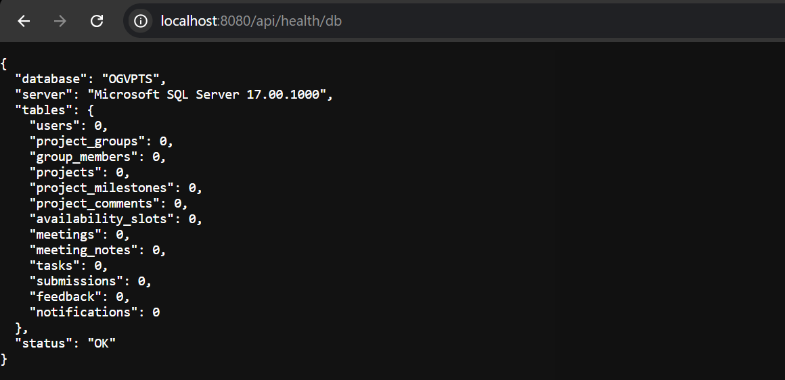
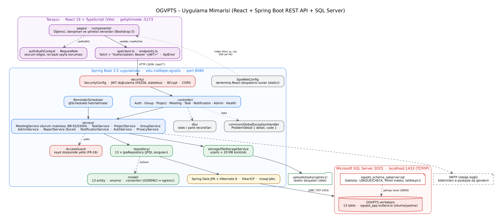
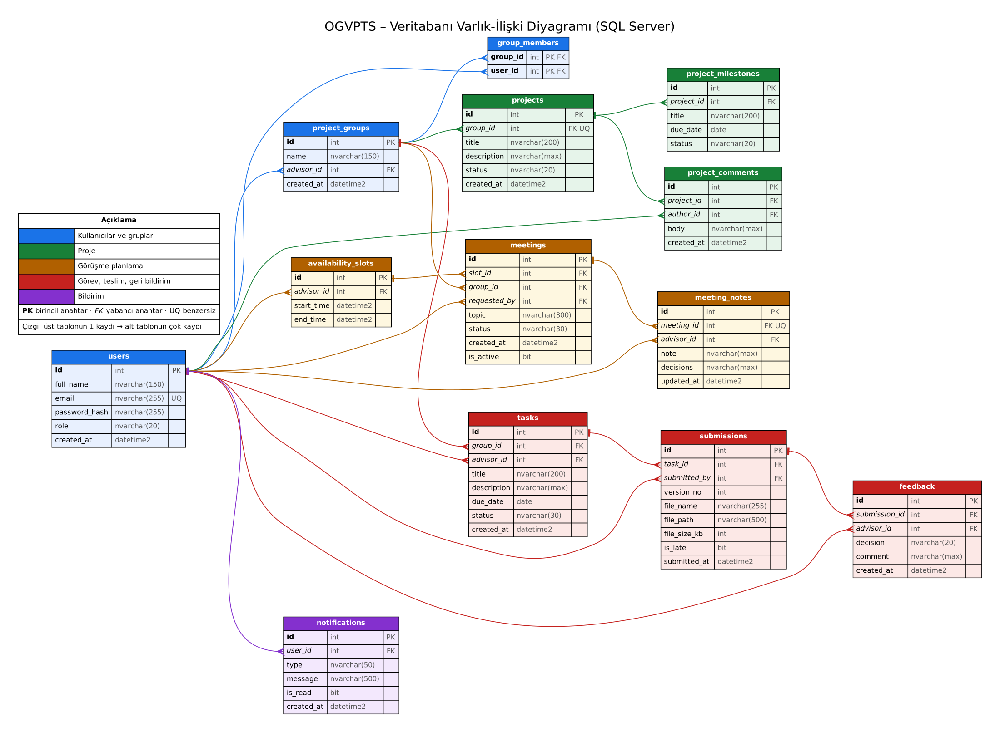

# OGVPTS – Öğrenci–Danışman Görüşme ve Proje Takip Sistemi

Maltepe Üniversitesi Yazılım Mühendisliği dersi kapsamında geliştirilen, öğrenci grupları ile danışman öğretim üyeleri arasındaki görüşme planlama, görev takibi, teslim ve geri bildirim süreçlerini tek ortamda yöneten uygulama.

Proje takibi Jira üzerinden yürütülmektedir (proje anahtarı: **OGVPTS**).

## Kapsam

- Üç kullanıcı rolü: **öğrenci**, **danışman** ve **yönetici** (bölüm sekreterliği)
- En fazla iki kişilik proje grupları; proje, aşamalar ve ilerleme takibi; danışman yorumları
- Danışman müsait saatleri; öğrencinin randevu talebi; danışmanın onay, red veya yeni saat önerisi; görüşme notu
- Danışmanın gruplara son teslim tarihli görev ataması; sürümlü teslimler; onay veya düzeltme isteği (eski teslim ve geri bildirimler silinmez)
- Uygulama içi bildirimler ve zamanlanmış hatırlatmalar (isteğe bağlı e-posta)
- Yönetici: kullanıcı yönetimi, grup–danışman eşleştirmesi, dönem raporu (Excel / PDF)
- Yetkilendirme: öğrenciler yalnızca kendi grubunun, danışmanlar yalnızca sorumlu oldukları grupların kayıtlarına erişir
- KVKK aydınlatma metni ve veri silme talebi

## Veritabanı

Veritabanı Microsoft SQL Server üzerinde kurulur.

**Kurulum:**

1. SQL Server Management Studio (SSMS) ile sunucuya bağlan.
2. `New Query` ile boş bir sorgu penceresi aç.
3. `ogvpts_schema_sqlserver.sql` dosyasının tamamını yapıştırıp çalıştır (F5).

Betik `OGVPTS` veritabanını oluşturur ve 13 tabloyu kurar:

`users`, `project_groups`, `group_members`, `projects`, `project_milestones`, `project_comments`, `availability_slots`, `meetings`, `meeting_notes`, `tasks`, `submissions`, `feedback`, `notifications`

**Şemaya işlenen iş kuralları:**

- Bir grupta en fazla 2 öğrenci olabilir.
- Bir öğrenci yalnızca tek bir grupta yer alır.
- Aynı saate iki onaylı görüşme eklenemez.
- Yüklenen dosya en fazla 20 MB olabilir.
- Her teslim ayrı kayıt olarak tutulur; önceki teslimler ve geri bildirimler silinmez.

## Uygulama

| | Teknolojiler |
|---|---|
| **Backend** (REST API) | Java 17+, Spring Boot 3.5, Spring Security (JWT), Spring Data JPA (Hibernate), SQL Server JDBC, springdoc (Swagger), Apache POI, Maven |
| **Frontend** | React 19, TypeScript, Vite, React Router, Bootstrap 5 |

**Klasör yapısı:**

```
src/main/java/edu/maltepe/ogvpts/
├── OgvptsApplication.java      # uygulamanın giriş noktası
├── security/                   # JWT, şifreleme, CORS, oturumdaki kullanıcı
├── controller/                 # REST uç noktaları (/api/...)
├── dto/                        # istek / yanıt şekilleri
├── service/                    # iş kuralları, randevu durum makinesi, yetki (AccessGuard)
├── storage/                    # teslim dosyalarının saklanması
├── repository/                 # her entity için Spring Data JPA repository
├── model/                      # 13 tablonun JPA entity sınıfları, enum'lar, dönüştürücüler
├── common/                     # hata yönetimi
└── config/                     # Swagger, ilk yönetici, demo verisi, sağlık kontrolü
src/main/resources/application.properties   # ayarlar
frontend/                                    # React + TypeScript arayüzü
docs/                                        # belgeler ve diyagramlar
```

| Tablo | Model sınıfı |
|---|---|
| users | `User` |
| project_groups | `ProjectGroup` |
| group_members | `GroupMember` (+ `GroupMemberId` bileşik anahtar) |
| projects | `Project` |
| project_milestones | `ProjectMilestone` |
| project_comments | `ProjectComment` |
| availability_slots | `AvailabilitySlot` |
| meetings | `Meeting` |
| meeting_notes | `MeetingNote` |
| tasks | `Task` |
| submissions | `Submission` |
| feedback | `Feedback` |
| notifications | `Notification` |

Şema `ogvpts_schema_sqlserver.sql` betiğiyle kurulur; Hibernate tablolara dokunmaz (`ddl-auto=none`).

### Kurulum ve çalıştırma (özet)

1. `ogvpts_schema_sqlserver.sql` ile `OGVPTS` veritabanını kur.
2. SQL Server'da **TCP/IP**'yi aç ve servisi **yeniden başlat**.
3. Uygulama için `ogvpts_app` veritabanı kullanıcısını oluştur.
4. `application-local.properties.example` dosyasını `application-local.properties` olarak kopyalayıp kullanıcı/şifreyi yaz (git'e gönderilmez).
5. Backend: IntelliJ'de `OgvptsApplication`'ı **`demo` profiliyle** çalıştır (*Edit Configurations → Active profiles: demo*) ya da `mvn spring-boot:run -Dspring-boot.run.profiles=demo`. Kontrol: `http://localhost:8080/api/health/db` → `"status": "OK"`.
6. Frontend: `cd frontend && npm install && npm run dev` → **http://localhost:5173**

Demo hesapları (şifre hepsinde `Demo1234!`):

| Rol | E-posta |
|---|---|
| Yönetici | `yonetici@ogvpts.test` |
| Danışman | `ayse.yildiz@ogvpts.test` |
| Öğrenci | `ali.demir@ogvpts.test` |

API'nin canlı belgesi: `http://localhost:8080/swagger-ui.html`

Adım adım anlatım ve sık karşılaşılan hatalar: **[docs/kurulum.md](docs/kurulum.md)**



## Belgeler

| | |
|---|---|
| [Mimari](docs/mimari.md) | Katmanlar, paket yapısı, tasarım kararları, gereksinimlerin koddaki karşılığı |
| [Veritabanı](docs/veritabani.md) | ERD, tablolar, iş kurallarının şemadaki karşılığı |
| [API](docs/api.md) | REST uç noktaları, yetkiler, hata kodları, randevu durum makinesi |
| [React rehberi](docs/react-rehberi.md) | Arayüz kodunu okuyarak React ve TypeScript öğrenmek için |
| [Kurulum](docs/kurulum.md) | Kurulum, çalıştırma, sorun giderme |
| [Geliştirme süreci](docs/gelistirme-sureci.md) | Jira sprintleri, dal/commit kuralları, GitHub–Jira entegrasyonu |





## Çalışma düzeni

- Çalışma 1 haftalık sprintlerle yürütülür: Sprint 1 gereksinim analizi, Sprint 2 diyagramlar, Sprint 3 veritabanı, Sprint 4 proje altyapısı.
- Commit mesajları ve dal adları Jira görev anahtarını içerir. Örnekler: `OGVPTS-54: veritabanı şeması eklendi`, `feature/OGVPTS-56-grup-olusturma`.

## Geliştirici

Mehmet Caner Kahraman – Maltepe Üniversitesi, Yazılım Mühendisliği
