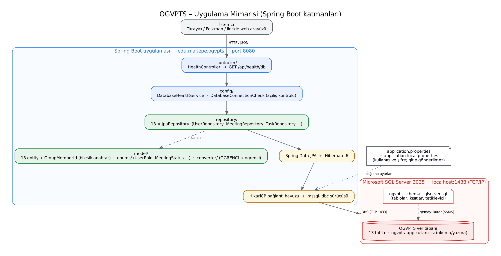

# OGVPTS Belgeleri

Öğrenci–Danışman Görüşme ve Proje Takip Sistemi'nin teknik belgeleri.

| Belge | İçerik |
|---|---|
| [Mimari](mimari.md) | Katmanlar, paket yapısı, bir isteğin uygulama içindeki yolu |
| [Veritabanı](veritabani.md) | Varlık-İlişki Diyagramı, tablolar, iş kurallarının şemadaki karşılığı |
| [API](api.md) | REST uç noktaları ve örnek yanıtlar |
| [Kurulum](kurulum.md) | SQL Server, bağlantı ayarları, çalıştırma ve sık karşılaşılan hatalar |
| [Geliştirme süreci](gelistirme-sureci.md) | Jira sprintleri, dal/commit kuralları, GitHub–Jira entegrasyonu |

## Görseller

| | |
|---|---|
|  |  |
| [Uygulama mimarisi](images/mimari.svg) | [Varlık-İlişki Diyagramı](images/erd.svg) |

Diyagramların SVG sürümleri yakınlaştırıldığında bozulmaz; tarayıcıda açıp büyütebilirsin.
