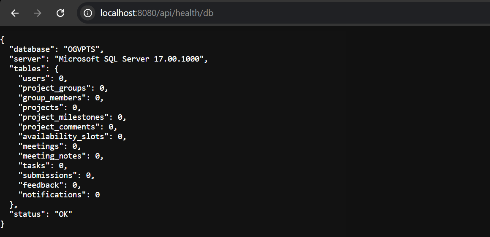

# API

Uygulama varsayılan olarak `http://localhost:8080` adresinde çalışır. Yanıtlar JSON biçimindedir.

## Uç noktalar

| Yöntem | Yol | Açıklama | Durum |
|---|---|---|---|
| `GET` | `/api/health/db` | Veritabanı bağlantısını ve 13 tablonun modellerle eşleşmesini kontrol eder | ✅ Hazır |

Kullanıcı, grup, görüşme, görev ve teslim uç noktaları sonraki sprintlerde eklenecek.

---

## `GET /api/health/db`

Veritabanına bağlanır, sunucu bilgisini okur ve her tabloyu kendi JPA modeliyle sorgular. Bir sütun adı veya tipi şemayla uyuşmazsa hata verir; bu yüzden modellerin doğruluğunu da test eder.

**Başarılı yanıt — `200 OK`**

```json
{
  "database": "OGVPTS",
  "server": "Microsoft SQL Server 17.00.1000",
  "tables": {
    "users": 0,
    "project_groups": 0,
    "group_members": 0,
    "projects": 0,
    "project_milestones": 0,
    "project_comments": 0,
    "availability_slots": 0,
    "meetings": 0,
    "meeting_notes": 0,
    "tasks": 0,
    "submissions": 0,
    "feedback": 0,
    "notifications": 0
  },
  "status": "OK"
}
```

`tables` altındaki sayılar, her tablodaki kayıt sayısıdır.

**Hata yanıtı — `503 Service Unavailable`**

```json
{
  "status": "HATA",
  "message": "Login failed for user 'ogvpts_app'."
}
```

**Ekran görüntüsü** (14.11.2026, yerel ortam):



## Uygulama açılışındaki kontrol

Aynı kontrol uygulama açılırken de çalışır (`DatabaseConnectionCheck`). Başarılıysa konsolda şu satırlar görünür:

```
Veritabanı bağlantısı başarılı: OGVPTS (Microsoft SQL Server 17.00.1000)
Tablo kayıt sayıları: {users=0, project_groups=0, ...}
```

Bağlantı kurulamazsa uygulama açılmaz ve hatanın nedeni konsola yazılır. Sık görülen hatalar için bkz. [Kurulum → Sorun giderme](kurulum.md#sorun-giderme).
