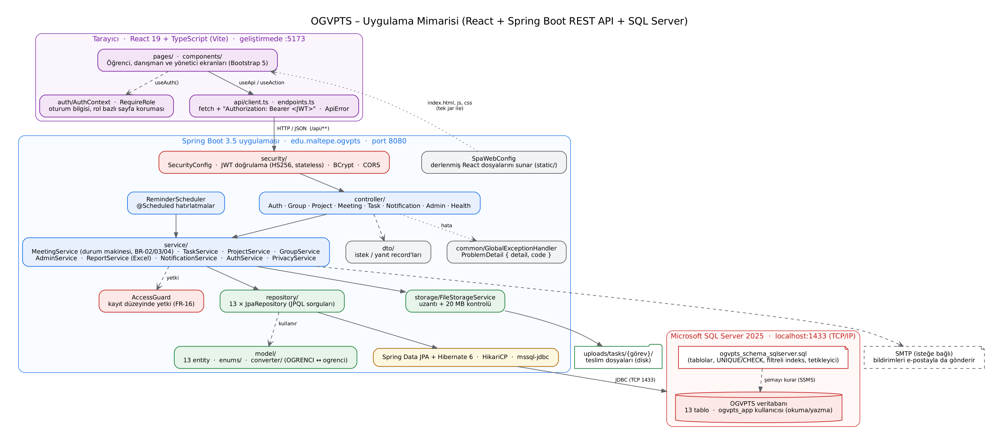

# Mimari

OGVPTS iki parçadan oluşur:

- **Backend:** katmanlı bir **Spring Boot** REST API'si. Veriler **Microsoft SQL Server** üzerindeki `OGVPTS` veritabanında tutulur; erişim **Spring Data JPA (Hibernate)** ile yapılır.
- **Frontend:** **React + TypeScript** ile yazılmış tek sayfalık uygulama (SPA). Backend ile yalnızca JSON üzerinden konuşur.



## Neden bu yapı?

| Karar | Gerekçe |
|---|---|
| Arayüz ile API'nin ayrılması | Aynı API ileride bir mobil uygulamaya da hizmet verebilir; arayüz ve backend birbirinden bağımsız geliştirilip test edilebilir |
| React + TypeScript | Sektörde en yaygın arayüz kütüphanesi; TypeScript, backend'deki DTO'larla uyuşmayan alan adlarını derleme anında yakalar |
| JWT (token) ile oturum | Sunucu oturum tutmaz (stateless); her istek kendi kimliğini taşır. Çerez kullanılmadığı için CSRF riski yoktur |
| Tek jar ile dağıtım seçeneği | `npm run build` çıktısı Spring Boot'un içine konup tek port üzerinden sunulabilir (bkz. [Kurulum §8](kurulum.md#8-tek-dosya-halinde-paketleme-isteğe-bağlı)) |

## Backend katmanları

| Katman | Paket | Görevi |
|---|---|---|
| Güvenlik | `security/` | JWT doğrulama, rol eşleme (`ROLE_OGRENCI` …), BCrypt, CORS; oturumdaki kullanıcıyı `CurrentUser` olarak verir |
| Sunum (REST) | `controller/` | HTTP isteğini karşılar, girdiyi doğrular (`@Valid`), servisi çağırır. İş kuralı içermez |
| Veri aktarımı | `dto/` | İstek/yanıt şekilleri (Java `record`). Entity'ler dışarı açılmaz; şifre özeti gibi alanlar sızmaz |
| İş / servis | `service/` | İş kuralları (BR-01..04), durum makinesi, bildirim üretimi. `@Transactional` sınırları burada |
| Yetki | `service/AccessGuard` | Kayıt düzeyinde erişim (FR-16): öğrenci yalnızca kendi grubunu, danışman yalnızca sorumlu olduğu grupları görür |
| Dosya | `storage/` | Teslim dosyalarını diskte saklar; uzantı ve 20 MB kontrolü (FR-06, FR-14) |
| Veri erişimi | `repository/` | Her tablo için bir `JpaRepository`; ihtiyaç olan sorgular JPQL ile açıkça yazıldı |
| Model | `model/` | Tabloların Java karşılıkları (entity), rol/durum enum'ları ve dönüştürücüler |
| Ortak | `common/` | `ApiException` ve tüm hataları tek biçime çeviren `GlobalExceptionHandler` |
| Yapılandırma | `config/` | Swagger, React dosyalarını sunma, ilk yönetici, demo verisi, sağlık kontrolü |

## Paket yapısı

```
src/main/java/edu/maltepe/ogvpts/
├── OgvptsApplication.java          # giriş noktası; @EnableScheduling
├── security/
│   ├── SecurityConfig.java         # hangi adres kime açık, JWT çözücü, CORS, BCrypt
│   ├── TokenService.java           # giriş sonrası JWT üretir (sub=id, roles, name)
│   ├── CurrentUser.java            # oturumdaki kullanıcı (id, rol, ad)
│   └── CurrentUserProvider.java    # token'dan CurrentUser okur
├── controller/                     # Auth, Group, Project, Meeting, Task, Notification, Admin, Health
├── dto/                            # *Dtos.java: istek/yanıt record'ları
├── service/
│   ├── MeetingService.java         # randevu durum makinesi (BR-02, BR-03, BR-04)
│   ├── AvailabilityService.java    # danışman müsaitlik saatleri
│   ├── TaskService.java            # görev, sürümlü teslim, geri bildirim
│   ├── ProjectService.java         # proje, aşama, danışman yorumu
│   ├── GroupService.java           # grup kurma, üye ekleme (en fazla 2; BR-01)
│   ├── AdminService.java           # kullanıcılar, grup–danışman eşleştirme ve kontenjan (FR-10)
│   ├── ReportService.java          # dönem raporu + Excel (Apache POI)
│   ├── NotificationService.java    # uygulama içi bildirim (+ isteğe bağlı e-posta)
│   ├── ReminderScheduler.java      # zamanlanmış hatırlatmalar
│   ├── AuthService.java, PrivacyService.java
│   └── AccessGuard.java            # kayıt düzeyinde yetki (FR-16)
├── storage/FileStorageService.java
├── common/                         # ApiException, GlobalExceptionHandler
├── config/                         # OpenApiConfig, SpaWebConfig, AdminBootstrap, DemoDataSeeder, sağlık kontrolü
├── repository/                     # 13 × JpaRepository
└── model/                          # 13 entity + GroupMemberId; enums/, converter/

frontend/src/                       # ayrıntı: docs/react-rehberi.md
├── api/                            # fetch sarmalayıcı, uç noktalar, tipler
├── auth/                           # AuthContext, RequireRole
├── hooks/                          # useApi, useAction
├── components/                     # Layout, Modal, StatusBadge, ProjectView ...
└── pages/                          # student/, advisor/, admin/, shared/
```

## Bir isteğin yolu

Danışmanın bir randevu talebini onaylaması (`POST /api/meetings/42/approve`):

1. **React** — `MeetingsPage.tsx` içindeki *Onayla* butonu `meetingApi.approve(42)` çağırır. `client.ts`, `localStorage`'daki token'ı `Authorization: Bearer …` başlığına ekler.
2. **Güvenlik** — `SecurityConfig` token'ın imzasını ve süresini doğrular, içindeki `roles` bilgisini Spring Security yetkisine çevirir. Token geçersizse istek burada `401` ile biter.
3. **Controller** — `MeetingController.approve()` oturumdaki kullanıcıyı (`CurrentUser`) alır ve servise verir.
4. **Servis** — `MeetingService.approve()`:
   - `AccessGuard`: bu görüşmenin saati, isteği yapan danışmana mı ait? Değilse `403`.
   - Durum `BEKLEMEDE` mi? Değilse `409 INVALID_STATUS`.
   - Aynı saatte onaylı başka görüşme var mı (BR-02)? Varsa `409 SLOT_CONFLICT`.
   - Durumu `ONAYLANDI` yapar; `NotificationService` grubun üyelerine bildirim yazar.
5. **Veri** — Hibernate, işlem (`@Transactional`) bitince `UPDATE meetings` ve `INSERT notifications` sorgularını gönderir. Veritabanındaki filtreli benzersiz indeks, iki isteğin tam aynı anda gelmesi gibi uç durumlarda BR-02'yi ikinci kez korur.
6. **Yanıt** — Güncel görüşme JSON olarak döner; React listeyi yeniler. Bir hata olduysa `GlobalExceptionHandler` onu `{ detail, code }` biçimine çevirir ve arayüz `detail` mesajını gösterir.

## Tasarım kararları

- **Şemanın sahibi SQL betiğidir.** Tablolar `ogvpts_schema_sqlserver.sql` ile kurulur; Hibernate tabloları oluşturmaz veya değiştirmez (`spring.jpa.hibernate.ddl-auto=none`). İş kuralları hem serviste (anlaşılır Türkçe hata için) hem de şemada (UNIQUE, CHECK, tetikleyici; son savunma hattı) bulunur. Şema kısıtı devreye girerse `GlobalExceptionHandler` kısıt adını Türkçe bir mesaja çevirir.
- **Yetki iki katmanlı.** Rol kontrolü (`/api/admin/**` yalnızca yönetici) `SecurityConfig`'te; "bu kayıt senin mi?" kontrolü ise her serviste `AccessGuard` ile yapılır. Arayüzdeki `RequireRole` yalnızca kullanıcı deneyimi içindir; güvenlik backend'dedir.
- **Durumlar türetilir.** Proje durumu aşamalarından, görev durumu teslim ve geri bildirimlerden hesaplanır; aynı bilgi iki yerde elle tutulmaz.
- **Teslimler sürümlüdür.** Her yükleme yeni bir `submissions` kaydı ve yeni bir dosyadır (`uploads/tasks/{görev}/{uuid}-{ad}`); eskiler silinmez. Geri bildirim yalnızca en son teslime ve bir kez verilir.
- **Rol ve durum değerleri enum'dur.** Veritabanındaki küçük harfli değerler (`ogrenci`, `beklemede` …) `LowercaseEnumConverter` ile Java enum'larına çevrilir. Dönüşümde `Locale.ROOT` kullanılır; Türkçe yerel ayarda `I → ı` hatası oluşmaz.
- **`meetings.is_active` uygulamada hesaplanır.** Durum `onaylandi` veya `tamamlandi` ise `true` olur (`@PrePersist/@PreUpdate`). Bu alan, aynı saate iki onaylı görüşme eklenmesini engelleyen filtreli benzersiz indeksi (BR-02) besler.
- **Hatalar tek biçimde.** Bütün hatalar RFC 9457 *Problem Details* yapısında ve Türkçe `detail` mesajıyla döner; ek `code` alanı arayüzün özel durumları (ör. danışman kontenjanı dolu → onay iste) ayırt etmesini sağlar.
- **Lombok kullanılmaz.** Yeni JDK sürümleriyle derleme hatası verdiği için getter/setter'lar açıkça yazılmıştır.
- **Uygulamaya özel veritabanı kullanıcısı.** Uygulama `sa` yerine yalnızca OGVPTS'de okuma/yazma yetkisi olan `ogvpts_app` kullanıcısıyla bağlanır.

## Gereksinimlerin karşılığı

| Gereksinim | Nerede |
|---|---|
| FR-01 Giriş, profil, şifre | `AuthService`, `SecurityConfig`, `LoginPage.tsx`, `AccountPage.tsx` |
| FR-02 Randevu talebi | `AvailabilityService.availableForStudent`, `MeetingService.request`, `advisor/SlotsPage.tsx` |
| FR-03 Onay / red / yeni saat önerisi | `MeetingService.approve/reject/proposeNewTime/acceptProposal/declineProposal` |
| FR-04 Görüşme notu | `MeetingService.saveNote`, `MeetingsPage.tsx` (not penceresi) |
| FR-05 Proje ve aşamalar | `ProjectService.create`, `MyProjectPage.tsx` |
| FR-06 İlerleme güncelleme, dosya (20 MB) | `ProjectService.updateMilestoneStatus`, `ProjectView.tsx`; dosya için bkz. sınırlama |
| FR-07 Danışmanın proje takibi ve yorumu | `ProjectService.listForAdvisor/addComment`, `advisor/ProjectsPage.tsx` |
| FR-08 Bildirim ve hatırlatmalar | `NotificationService`, `ReminderScheduler`, `NotificationsPage.tsx` |
| FR-09 Görüşme geçmişi ve filtre | `MeetingService.list`, `MeetingsPage.tsx` |
| FR-10 Grup–danışman eşleştirme, kontenjan | `AdminService.assignAdvisor`, `admin/AssignmentsPage.tsx` |
| FR-11 Raporlar | `ReportService`, `admin/ReportsPage.tsx` |
| FR-12 Proje grupları (en fazla 2 öğrenci) | `GroupService`, `student/GroupPage.tsx`, şemadaki `trg_group_max_two` |
| FR-13, FR-14, FR-15 Görev, teslim, geri bildirim | `TaskService`, `FileStorageService`, `TasksPage.tsx`, `TaskDetailPage.tsx` |
| FR-16 Kayıt düzeyinde yetki | `AccessGuard` |
| BR-01 Öğrenci tek grupta, grubun tek danışmanı | `group_members.user_id` UNIQUE, `project_groups.advisor_id` |
| BR-02 Aynı saate tek onaylı görüşme | `MeetingService.requireNoActiveConflict` + filtreli benzersiz indeks |
| BR-03 24 saat iptal kuralı | `MeetingService.cancel` (`ogvpts.meeting.cancel-min-hours`) |
| BR-04 Not yalnızca görüşmeyi yapan danışmanın | `MeetingService.saveNote` |
| ROL-01..03 Öğrenci, danışman, yönetici | `SecurityConfig` (`/api/admin/**`), `RequireRole`, rol bazlı menü (`Layout.tsx`) |
| NFR-02 Şifre güvenliği | BCrypt; şifreler düz metin tutulmaz |
| NFR-03 KVKK | `PrivacyPage.tsx`, `PrivacyService` (veri silme talebi) |
| NFR-04 Mobil uyumluluk | Bootstrap ızgarası, daraltılabilir menü, kaydırılabilir tablolar |

**Bilinen sınırlama:** FR-06'daki aşamaya doğrudan dosya ekleme için şemada tablo bulunmuyor; dosyalar görev teslimi olarak yükleniyor. Ayrıntı: [API → Bilinen sınırlama](api.md#bilinen-sınırlama).

## Teknolojiler

| | Sürüm |
|---|---|
| Java | 17+ (geliştirmede OpenJDK 27 ile test edildi) |
| Spring Boot | 3.5.6 (Web, Data JPA, Security, OAuth2 Resource Server, Validation, Mail) |
| Hibernate ORM | 6.6 |
| SQL Server JDBC sürücüsü | mssql-jdbc 12.10 |
| springdoc-openapi (Swagger) | 2.8.9 |
| Apache POI (Excel) | 5.4.1 |
| Veritabanı | Microsoft SQL Server 2025 (17.0) |
| React | 19.3 |
| TypeScript | 7.0 |
| Vite | 8.3 |
| React Router | 7.18 |
| Bootstrap / Bootstrap Icons | 5.3 |
| Derleme | Maven (backend), npm (frontend) |
