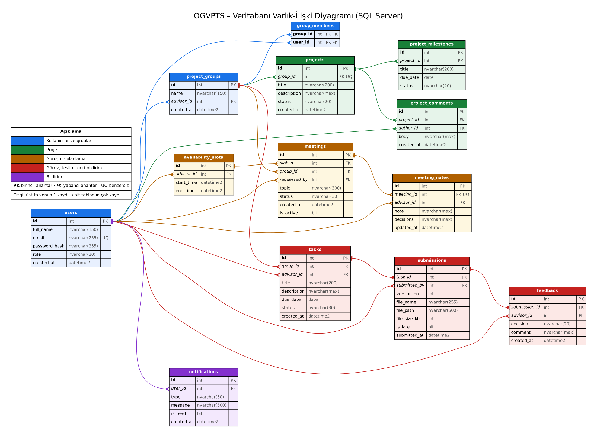

# Veritabanı

Veritabanı **Microsoft SQL Server** üzerinde, `ogvpts_schema_sqlserver.sql` betiğiyle kurulur. Betik `OGVPTS` veritabanını ve 13 tabloyu oluşturur.



> Büyütülebilir sürüm: [images/erd.svg](images/erd.svg). Diyagram, SQL betiğinden otomatik üretilmiştir; şemayla birebir aynıdır.
> **PK** birincil anahtar · ***FK*** yabancı anahtar · **UQ** benzersiz. Çizgiler üst tablonun bir kaydından alt tablonun birden çok kaydına gider.

## Tablolar

| Grup | Tablo | Java sınıfı | Açıklama | Gereksinim |
|---|---|---|---|---|
| Kullanıcılar ve gruplar | `users` | `User` | Öğrenci, danışman ve yönetici hesapları; şifre hash olarak tutulur | FR-01, NFR-02 |
| | `project_groups` | `ProjectGroup` | Proje grubu ve sorumlu danışmanı | FR-10, FR-12 |
| | `group_members` | `GroupMember` | Öğrenci–grup üyeliği (bileşik anahtar) | FR-12, BR-01 |
| Proje | `projects` | `Project` | Grubun projesi (her grubun tek projesi) | FR-05 |
| | `project_milestones` | `ProjectMilestone` | Proje aşamaları ve teslim tarihleri | FR-05, FR-06 |
| | `project_comments` | `ProjectComment` | Danışmanın projeye yorumları | FR-07 |
| Görüşme planlama | `availability_slots` | `AvailabilitySlot` | Danışmanın müsait saatleri | FR-02 |
| | `meetings` | `Meeting` | Grubun görüşme talebi ve durumu | FR-03, FR-04 |
| | `meeting_notes` | `MeetingNote` | Görüşme notu ve alınan kararlar | FR-09, BR-04 |
| Görev, teslim, geri bildirim | `tasks` | `Task` | Danışmanın gruba atadığı görev | FR-13 |
| | `submissions` | `Submission` | Öğrencinin teslimi (her teslim ayrı sürüm) | FR-14, FR-06 |
| | `feedback` | `Feedback` | Danışmanın teslime kararı ve yorumu | FR-15 |
| Bildirim | `notifications` | `Notification` | Kullanıcıya giden bildirimler | FR-08 |

## Durum değerleri

| Sütun | Değerler | Java enum |
|---|---|---|
| `users.role` | `ogrenci`, `danisman`, `yonetici` | `UserRole` |
| `projects.status`, `project_milestones.status` | `baslamadi`, `devam_ediyor`, `tamamlandi` | `ProjectStatus` |
| `meetings.status` | `beklemede`, `onaylandi`, `reddedildi`, `yeni_saat_onerildi`, `tamamlandi`, `iptal` | `MeetingStatus` |
| `tasks.status` | `atandi`, `teslim_edildi`, `duzeltme_istendi`, `onaylandi` | `TaskStatus` |
| `feedback.decision` | `onay`, `duzeltme` | `FeedbackDecision` |

## İş kuralları ve şemadaki karşılıkları

| Kural | Nasıl uygulanıyor |
|---|---|
| Bir grupta en fazla 2 öğrenci olabilir (FR-12) | `trg_group_max_two` tetikleyicisi; 3. üye eklenirse işlem geri alınır |
| Bir öğrenci yalnızca tek grupta olabilir (BR-01) | `group_members.user_id` **UNIQUE** |
| Her grubun tek projesi vardır | `projects.group_id` **UNIQUE** |
| Danışmanın aynı başlangıç saatinde iki müsaitliği olamaz (BR-02) | `uq_slot_advisor_start` (advisor_id, start_time) **UNIQUE** |
| Aynı saate iki onaylı görüşme olamaz (BR-02) | `ux_meeting_slot_active`: `is_active = 1` olan kayıtlarda `slot_id` **filtreli benzersiz indeks** |
| Bitiş saati başlangıçtan sonra olmalı | `ck_slot_time` **CHECK** |
| Her görüşmenin en fazla bir notu olur (BR-04) | `meeting_notes.meeting_id` **UNIQUE** |
| Yüklenen dosya en fazla 20 MB (FR-06) | `ck_file_size` **CHECK** (`file_size_kb <= 20480`) + Java'da `@Max` |
| Önceki teslimler silinmez | Her teslim yeni satır; `uq_submission_version` (task_id, version_no) **UNIQUE** |
| "Düzeltme" kararında yorum zorunlu (FR-15) | `ck_feedback_comment` **CHECK** |

## Veritabanı kullanıcısı

Uygulama `sa` hesabıyla değil, yalnızca bu veritabanında yetkisi olan `ogvpts_app` kullanıcısıyla bağlanır:

```sql
USE master;
CREATE LOGIN ogvpts_app WITH PASSWORD = N'<güçlü-bir-şifre>', DEFAULT_DATABASE = OGVPTS;
USE OGVPTS;
CREATE USER ogvpts_app FOR LOGIN ogvpts_app;
ALTER ROLE db_datareader ADD MEMBER ogvpts_app;
ALTER ROLE db_datawriter ADD MEMBER ogvpts_app;
```

Şifre yalnızca `src/main/resources/application-local.properties` dosyasında tutulur ve depoya gönderilmez (bkz. [Kurulum](kurulum.md)).
